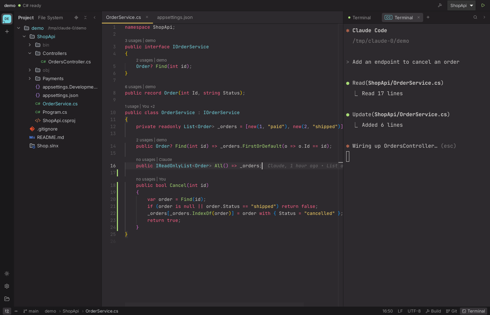

# Haze

Không gian làm việc nhẹ dành cho việc lập trình cùng AI agent (Claude Code, Codex…), hướng tới người dùng .NET quen với Rider: cây file và quản lý Git kiểu Rider, editor đủ dùng để đọc và điều hướng code, terminal không bao giờ mất phiên.

> A lightweight, AI-first workspace: Rider-style project view and Git tooling, a capable editor, and terminals that survive restarts.



Trạng thái: **giai đoạn 4** (Git kiểu Rider/Rebased). Lộ trình đầy đủ: [docs/ROADMAP.md](docs/ROADMAP.md).

## Đã có

**Project**
- Thanh project bên trái: mở nhiều project, yêu thích, sắp xếp, đóng/mở lại; màn hình Welcome liệt kê project gần đây.
- Khôi phục toàn bộ khi mở lại: project, thư mục đang mở rộng, tab editor, kích thước panel, terminal.

**Cây file (Project view)**
- Tải từng cấp, ảo hóa (chỉ vẽ dòng đang thấy), tự cập nhật khi file trên đĩa thay đổi.
- Màu theo trạng thái git như Rider: sửa (xanh), mới thêm (xanh lá), chưa track (đỏ), bị ignore (vàng nhạt), xung đột; thư mục chứa thay đổi cũng được tô màu.
- Lồng file kiểu Rider: `appsettings.Development.json` dưới `appsettings.json`, `Index.razor.cs` dưới `Index.razor`, `Strings.Designer.cs` dưới `Strings.resx`, `App.csproj.user` dưới `App.csproj`…
- New File / New Directory (Alt+Insert), Rename (Shift+F6 / F2), Delete vào thùng rác, Cut/Copy/Paste (Ctrl+X/C/V), kéo thả để di chuyển (giữ Ctrl để copy), Copy Path (Ctrl+Shift+C), Open in Terminal, Reveal in File Manager.
- Chọn nhiều bằng Ctrl/Shift, điều hướng bằng bàn phím.

**Editor (Monaco)**
- Tab xem trước (click một lần: tab nghiêng, bị thay bởi file kế tiếp; double-click hoặc sửa thì giữ lại).
- Giữ nguyên encoding (UTF-8, UTF-8 BOM, UTF-16) và kiểu xuống dòng (LF/CRLF) khi lưu; ghi file an toàn qua file tạm.
- **Không ghi đè âm thầm**: file chưa sửa tự tải lại khi AI sửa trên đĩa; file đang sửa dở thì hiện thông báo với "Load disk version" / "Overwrite with mine"; lưu bị chặn nếu file trên đĩa đã đổi.
- Bản nháp chưa lưu được giữ qua lần tắt/mở app.
- Ctrl+S lưu tất cả, Ctrl+F4 đóng tab, Ctrl+Tab chuyển tab.

**Tìm kiếm (giai đoạn 2)**
- **Double Shift — Search Everywhere** với các tab All / Files / Actions / Text. Tìm mờ tên file như Rider (`ordcon` → `OrdersController.cs`), ưu tiên trùng tên file, gõ `Tên.cs:12` để nhảy tới dòng. Ctrl+Shift+N: Go to File, Ctrl+Shift+A: Find Action, Ctrl+E: file mở gần đây.
- **Find in Files (Ctrl+Shift+F) / Replace in Files (Ctrl+Shift+R)**:
  - Regex đầy đủ (lookahead/lookbehind, backreference), thay thế bằng `$1`, `${name}`; Match case, Words, Preserve case.
  - Phạm vi: In Project / Directory / Open Files; file mask `*.cs, !*.Designer.cs`; mặc định bỏ `bin/`, `obj/`, `node_modules/` và file trong `.gitignore` (có ô "Include ignored").
  - Lọc ngữ cảnh cho C# (phân tích bằng tree-sitter): Anywhere / In comments / In string literals / Except….
  - Đọc đúng file UTF-16 và UTF-8 BOM; khi ghi giữ nguyên encoding, BOM, CRLF.
  - File đang mở được tìm trên nội dung chưa lưu và thay ngay trong editor (Ctrl+Z được); file không mở thì ghi trên đĩa.
  - Trước khi ghi, chạy lại tìm kiếm trên nội dung hiện tại: file đổi kể từ lúc tìm (ví dụ AI vừa sửa) thì bỏ qua và báo lại, không ghi đè.
  - Xem trước từng chỗ thay (cũ gạch đỏ, mới xanh), tick/bỏ tick từng chỗ hoặc cả file, khung xem code xung quanh; nút **Undo** hoàn tác cả lượt.
- Mở rộng tìm kiếm từ thư mục đang chọn trong Project view, hoặc lấy sẵn chữ đang bôi đen trong editor.

**Editor (giai đoạn 2)**
- **Copy Context (Ctrl+Shift+C)**: copy đoạn code kèm `đường/dẫn.cs:7-9` và khối code Markdown, để dán cho AI.
- Phím kiểu Rider: Ctrl+D nhân đôi dòng, Ctrl+Y xóa dòng, Ctrl+R thay thế trong file, Ctrl+W/Ctrl+Shift+W mở rộng/thu hẹp vùng chọn, Alt+J chọn chỗ trùng tiếp theo, Alt+Shift+↑/↓ di chuyển dòng, Alt+F1 tìm file đang mở trong Project view.
- Xem trước Markdown (Source/Preview), xem ảnh (png, jpg, gif, webp, svg…).

**C# và .NET (giai đoạn 3)**
- Dùng **Roslyn Language Server** (`roslyn-language-server`, bản .NET tool của Microsoft); dự phòng `csharp-ls`. Nếu chưa cài, thanh trên cùng có nút **Install** chạy `dotnet tool install --global roslyn-language-server --prerelease`.
- Điều hướng kiểu Rider: **Ctrl+B / Ctrl+click** tới định nghĩa (mở được cả file khác), **Alt+F7 / Shift+F12** Find Usages, **Ctrl+Alt+B** Go to Implementation, **Ctrl+F12** cấu trúc file, **Shift+F6** Rename (đổi tên qua nhiều file, một lần Undo), **Alt+Enter** quick fix/refactoring của Roslyn, **Ctrl+Alt+L** format, hover, completion, gợi ý tham số, tô sáng các chỗ dùng.
- **Không có lỗi "ảo"**: Haze không lấy lỗi từ language server. Lỗi chỉ đến từ build thật: **Ctrl+Shift+B** chạy `dotnet build`, panel **Build** liệt kê lỗi/cảnh báo MSBuild (bấm để nhảy tới), và vạch đỏ trong editor; vạch đỏ của file nào sẽ tự xóa khi file đó bị sửa, cho tới lần build sau.
- Thanh **Run**: cấu hình chạy lấy từ `launchSettings.json` của từng project (và `dotnet test` nếu có project test). **Shift+F10** chạy trong một tab terminal riêng (vẫn sống khi đóng Haze).
- Double Shift có thêm tab **Symbols** (tìm class/method mờ, ví dụ `OrdSer`), Find in Files có thêm phạm vi **Solution** (đọc `.sln`/`.slnx`).
- File do AI tạo/sửa/xóa trên đĩa được báo cho Roslyn (`workspace/didChangeWatchedFiles`), nên điều hướng luôn theo code mới.

**Git (giai đoạn 4)** — tự viết, gọi git CLI; giao diện theo Rider/Rebased
- **Commit (Alt+0, Ctrl+K)**: tick từng file để commit, không cần stage; nhóm Changes / Unversioned Files / Merge Conflicts; Amend (tự điền message cũ); Commit and Push; Rollback (hỏi trước khi xóa file mới); Add to VCS, Add to .gitignore; banner Continue/Abort khi đang merge/rebase dở.
- **Git (Alt+9)**: log có **đồ thị nhánh** (lane tính trên toàn bộ lịch sử đã tải, tải thêm khi cuộn), nhãn branch/tag/remote, lọc theo text/hash, tác giả, nhánh, đường dẫn, First parent; danh sách nhánh bên trái; chi tiết commit và file thay đổi bên phải; tab **Console** ghi lại mọi lệnh git Haze đã chạy.
- Menu commit: Copy Revision, Checkout Revision, New Branch, New Tag, Cherry-Pick, Revert, Undo Commit, Reset Current Branch to Here (Soft/Mixed/Hard).
- **Branches** (bấm tên nhánh ở thanh trạng thái, hoặc Ctrl+Shift+\`): tìm nhánh, Checkout (có **Smart Checkout** tự stash khi có thay đổi), New Branch, Merge into current, Rebase onto, Compare, Push, Rename, Delete (hỏi khi chưa merge), xóa nhánh trên remote; Fetch.
- **Push (Ctrl+Shift+K)**: liệt kê các commit sẽ push, chọn remote/nhánh đích, `--force-with-lease`; tự đặt upstream cho nhánh mới. **Update Project (Ctrl+T)**: pull kiểu Merge hoặc Rebase, tự stash/khôi phục thay đổi.
- **Diff** mở như một tab (F7 / Shift+F7 để nhảy giữa các khác biệt); với file đang sửa, bên phải chính là file thật nên sửa trực tiếp được.
- **Annotate with Git Blame**, **Show History for File**, **Compare with HEAD** từ menu chuột phải của editor và cây file.
- **Xung đột**: nhóm Merge Conflicts trong cửa sổ Commit (tự mở khi merge/rebase/cherry-pick gặp xung đột); Accept Yours / Accept Theirs, hoặc **cửa sổ merge 3 khung** (Yours | Result | Theirs): thay đổi không xung đột được gộp sẵn, mỗi xung đột chọn « Left / Both / Right » hoặc sửa tay, Apply ghi file và `git add`; sau đó Continue.
- **Interactive Rebase from Here…** (menu commit trong log): sắp xếp lại, pick / reword / edit / squash / fixup / drop — không cần mở trình soạn thảo văn bản.
- **Stashes** (tab trong cửa sổ Git): xem nội dung, Apply, Pop, Drop, Unstash as Branch, Stash Changes (kèm file chưa track).
- **Checkpoint cho AI** (nút máy ảnh trong cửa sổ Commit): chụp toàn bộ thư mục làm việc (kể cả file mới, không đụng index/nhánh) trước khi để agent chạy; mục **Since checkpoint** liệt kê mọi file agent đã đổi, bấm để xem diff so với lúc chụp.
- **Đánh dấu đã review** từng file (biểu tượng con mắt); dấu tự mất khi file bị sửa lại.
- Không bao giờ chờ nhập mật khẩu (`GIT_TERMINAL_PROMPT=0`): cần credential helper hoặc SSH agent; lỗi xác thực hiện ngay thành thông báo.

**Terminal**
- Shell chạy trong một tiến trình nền riêng (PTY host): **đóng hay cập nhật Haze không giết shell hay AI agent đang chạy**; mở lại là nối lại đúng phiên, phát lại output gần nhất (4 MB/phiên).
- Nhiều tab, tìm trong output (Ctrl+F), Ctrl+C copy khi có vùng chọn.
- **Ctrl+click vào đường dẫn** để mở file đúng dòng/cột: hiểu định dạng lỗi MSBuild/`dotnet build` (`Program.cs(12,5): error CS1002`) lẫn `file:line:col`.
- Alt+F12 bật/tắt terminal như Rider, Alt+1 bật/tắt Project view.
- Biến môi trường `HAZE_TERMINAL_ID` có sẵn trong mỗi terminal (dùng cho hook AI agent ở giai đoạn 5).

## Chạy và build

Yêu cầu: Node.js 20+, Rust stable, git; trên Linux cần thêm `libwebkit2gtk-4.1-dev libgtk-3-dev librsvg2-dev`.

Cho C#: .NET SDK (Roslyn Language Server cần .NET 10 runtime) và `dotnet tool install --global roslyn-language-server --prerelease`.

```bash
npm install
npm run tauri dev        # chạy bản dev
npm run tauri build      # build bản cài đặt
```

Kiểm tra:

```bash
npm run build && npm test                       # TypeScript + Vite + Vitest
cd src-tauri && cargo test && cargo clippy      # Rust
```

## Kiến trúc

| Phần | Công nghệ |
|---|---|
| Vỏ app | Tauri 2 (Rust) |
| Giao diện | React 19 + TypeScript + zustand |
| Editor | Monaco |
| Terminal | xterm.js + `portable-pty`, PTY host riêng nói chuyện qua local socket (`interprocess`) |
| Theo dõi file | `notify` |
| Git | git CLI của hệ thống |
| C# | Roslyn Language Server qua LSP (stdio), client JSON-RPC tự viết trong `src/lib/lsp` |
| Tìm kiếm | `ignore` (bộ duyệt file của ripgrep), `fancy-regex`, `globset`, `nucleo-matcher`, `tree-sitter-c-sharp` |

```
src/                    giao diện (React)
  components/           FileTree, EditorArea, TerminalPanel, SearchEverywhere, FindInFiles, Shell, Overlays
  lib/                  ipc (gọi Rust), buffers (file đang mở), monaco, path, termLinks, workspaceEdit
  lib/lsp/              client JSON-RPC, phiên C# + provider cho Monaco
  store/                workspace (project, tab), tree, terminals, persist
src-tauri/src/
  fs_ops.rs             thao tác file, đọc/ghi giữ encoding
  nesting.rs            luật lồng file kiểu Rider
  git.rs                git status cho cây file
  watcher.rs            theo dõi thay đổi trên đĩa
  search.rs             Find/Replace in Files, hoàn tác
  syntax.rs             vùng comment/string của C# (tree-sitter)
  file_index.rs         danh sách file + tìm mờ cho Double Shift
  lsp.rs                chạy language server, chuyển tin nhắn LSP
  dotnet.rs             tìm solution/project/launch profile, chạy dotnet build và tách lỗi MSBuild
  git_log.rs            git log + tính lane cho đồ thị nhánh
  git_ops.rs            thay đổi cục bộ, commit theo file, rollback, branch, stash, blame
  pty/                  PTY host (host.rs), client (client.rs), giao thức (protocol.rs)
```

Tiến trình PTY host chính là file chạy `haze` với tham số `--pty-host`. Nó tự thoát sau 60 giây khi không còn cửa sổ Haze nào kết nối và không còn shell nào đang chạy.

## Giấy phép

Chưa chọn. Haze chỉ tham khảo **ý tưởng** từ Tervia (AGPL-3.0), không dùng code của Tervia.
