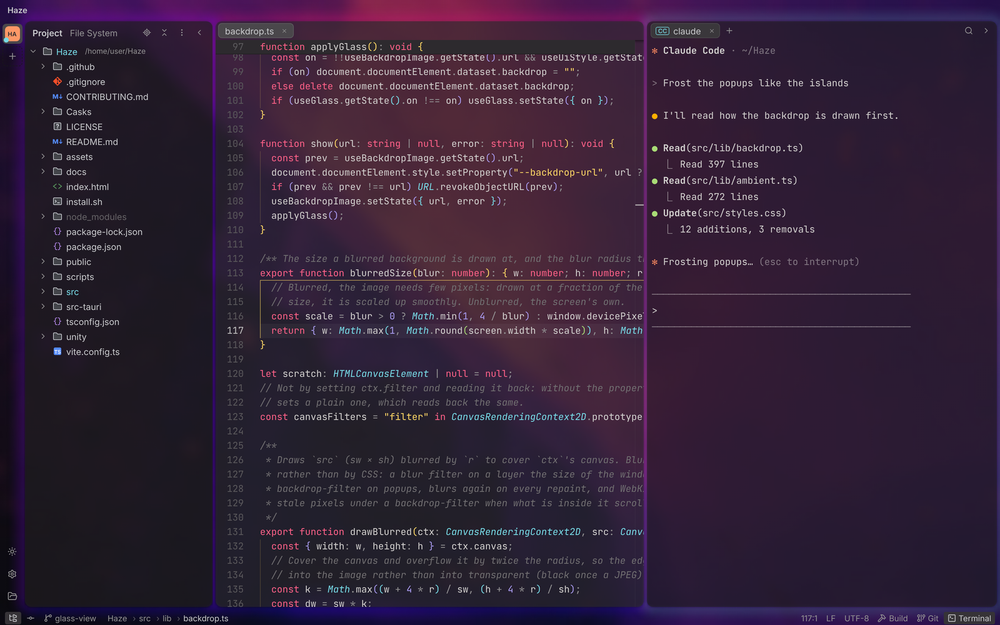
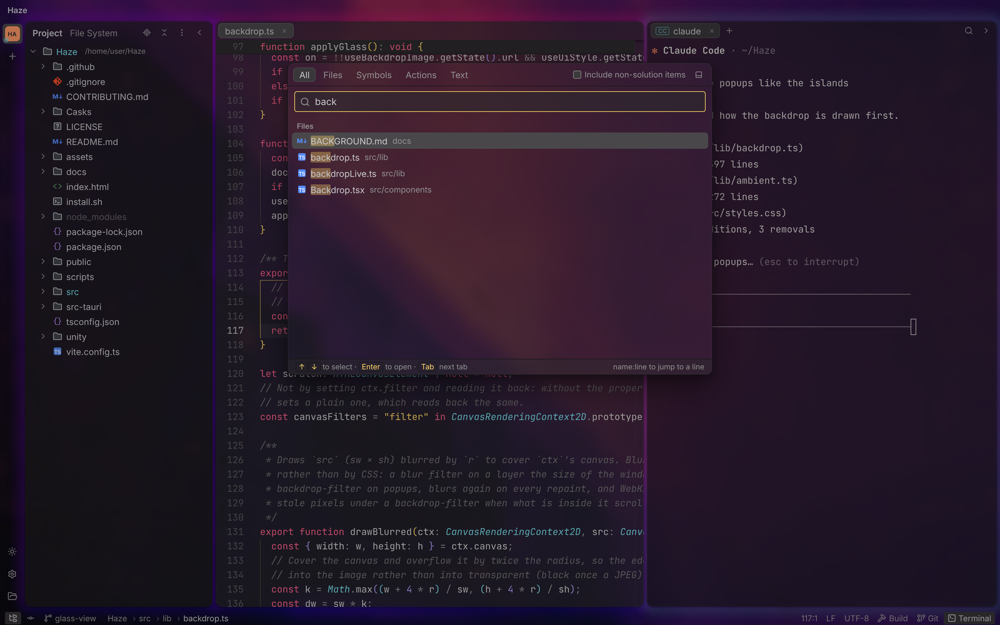
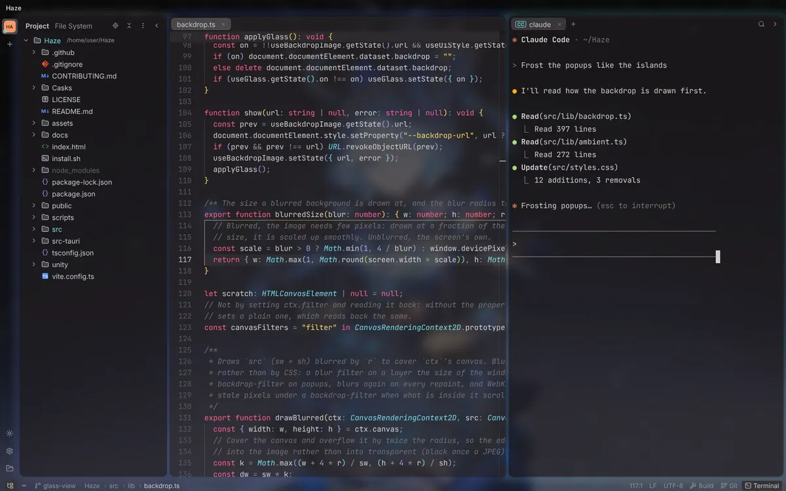
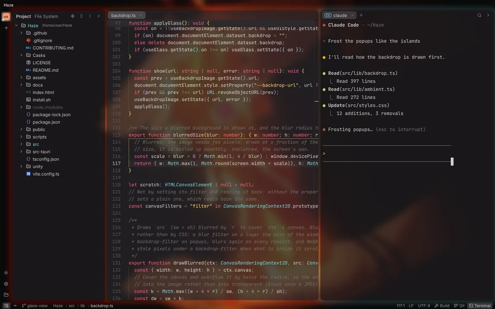

<h1 align="center">
   Haze
</h1>

<p align="center">
  <a href="LICENSE"></a>
  
  
</p>

<p align="center">
  <strong>A lightweight, AI-first workspace for coding alongside Claude Code, Codex and friends.</strong><br>
  Rider-style project view and Git tooling, a capable C# editor, and terminals that survive restarts.
</p>

<h3 align="center"><a href="#install"><ins>Install Haze</ins></a> · <a href="docs/FEATURES.md">All features</a> · <a href="#haze-vs-rider">Haze vs Rider</a></h3>


## Why Haze?

When an AI agent writes most of the code, a full IDE is heavy and noisy, and a plain terminal is too bare. Haze sits in between. It is aimed at .NET and Unity developers used to JetBrains Rider, and keeps the parts of Rider that matter when you are reviewing and steering agents.

## Features

<table>
<tr>
<td width="50%" valign="middle">

### Agents that never die

Shells and agents run in a separate PTY host, so closing, crashing or updating Haze does not kill them. Status badges and desktop notifications for Claude Code, Codex, Gemini and OpenCode.

[Docs →](docs/FEATURES.md#ai-agents)

</td>
<td width="50%"></td>
</tr>
<tr>
<td width="50%" valign="middle">

### Review what the agent did

Rider-style commit window, diffs, log graph, AI checkpoints and per-file "reviewed" marks. Roll back what you don't want, commit the rest.

[Docs →](docs/FEATURES.md#git)

</td>
<td width="50%"></td>
</tr>
<tr>
<td width="50%" valign="middle">

### C# navigation with Roslyn

Go to Definition, Find Usages, Rename, quick fixes, Code Vision and inline completions through the Roslyn Language Server. Errors, warnings, suggestions and hints as you type, like Rider's, and Unity's performance-critical context.

[Docs →](docs/FEATURES.md#c-and-net)

</td>
<td width="50%"></td>
</tr>
<tr>
<td width="50%" valign="middle">

### Search Everywhere

Double `Shift` for files, symbols, actions and text, with Rider's fuzzy matching and a code preview.

[Docs →](docs/FEATURES.md#search)

</td>
<td width="50%"></td>
</tr>
<tr>
<td width="50%" valign="middle">

### Safe Replace in Files

Full regex, Rider's scopes, a C# comment/string filter, and one-click Undo. Files the agent changed since the search are skipped, never overwritten.

[Docs →](docs/FEATURES.md#search)

</td>
<td width="50%"></td>
</tr>
<tr>
<td width="50%" valign="middle">

### 3-way merge

Yours | Result | Theirs with non-conflicting changes pre-merged, plus interactive rebase, stashes and cherry-pick.

[Docs →](docs/FEATURES.md#git)

</td>
<td width="50%"></td>
</tr>
<tr>
<td width="50%" valign="middle">

### Rider keymap

Rider's shortcuts out of the box (the ReSharper keymap on macOS), fully remappable.

[Docs →](docs/FEATURES.md#keymap-and-updates)

</td>
<td width="50%"></td>
</tr>
<tr>
<td width="50%" valign="middle">

### Glass view

Put an image or a video behind the Islands layout: the panels and popups turn into frosted glass over it, lit in its colours by an ambient glow. Blur, dim and opacity are adjustable, and a 1080p video costs about 4 % of one core (Apple M4).

[Docs →](docs/BACKGROUND.md)

</td>
<td width="50%"></td>
</tr>
</table>

<table>
<tr>
<td width="50%"></td>
<td width="50%"></td>
</tr>
<tr>
<td width="50%"></td>
<td width="50%" valign="middle">

Shown with blur 10, dim 40 %, panel opacity 65 %, popup opacity 65 % and ambient glow 55 %.

</td>
</tr>
</table>

**Also in the box:**

- **[Unity live link](docs/FEATURES.md#c-and-net)**: compile, Console, Play/Pause, asset usages in Code Vision and Unity tests, through the [`com.aprius.ide.haze`](unity/com.aprius.ide.haze) package.
- **[No silent overwrites](docs/FEATURES.md#editor-monaco)**: files changed on disk reload automatically, and conflicting edits are always surfaced.
- **[Worktree per agent and a `haze` CLI](docs/FEATURES.md#ai-agents)**: `haze agent claude --worktree fix/login "…"`, then `send`, `wait` and `read` from scripts or other agents.
- **[Copy Context](docs/FEATURES.md#editor-monaco)** (`Ctrl+Shift+C`): the selection as `path:line` plus a code fence, ready to paste into an agent.
- **[Full session restore](docs/FEATURES.md#projects-and-file-tree)**: projects, tabs, unsaved drafts, layout and terminals.
- **[GitHub / GitLab accounts](docs/FEATURES.md#git)** with tokens in the system keychain.
- **And more**: see the [full feature reference](docs/FEATURES.md).

## Supported agents

Works with any CLI agent: if it runs in a terminal, it runs in Haze. Status badges and notifications are built in for:

<kbd>Claude Code</kbd> &nbsp; <kbd>Codex</kbd> &nbsp; <kbd>Gemini CLI</kbd> &nbsp; <kbd>OpenCode</kbd> &nbsp; <kbd>+ any agent that prints <code>OSC 6973</code></kbd>

## Install

**macOS**: one universal build for Apple Silicon and Intel.

```bash
curl -fsSL https://raw.githubusercontent.com/aprius/Haze/main/install.sh | bash
```

Or with Homebrew:

```bash
brew tap aprius/haze https://github.com/aprius/Haze
brew install --cask haze
```

**Update** (Homebrew):

```bash
haze update
```

**Windows / Linux**: download from [Releases](https://github.com/aprius/Haze/releases): `-setup.exe` or `.msi` (Windows), `.deb`, `.rpm` or `.AppImage` (Linux).

**Updating**: when a new version is out, click **Update Now** (the arrow above Settings). Haze downloads it, installs it and restarts; terminals keep running. A Homebrew install updates through Homebrew in Terminal. A `.deb`/`.rpm` install, or an `.msi` one under Program Files, opens the release page instead.

**For C#**: if the Roslyn Language Server (or the .NET SDK) is missing, Haze offers a one-click install.

## Quick start

1. Open a folder from the Welcome screen.
2. Open a terminal (`Alt+F12`, `Cmd+J` on macOS) and start your agent, e.g. `claude` or `codex`.
3. Optional: in **Settings** (`Ctrl+Alt+S`) → AI Agents, install the hook for status badges and notifications.
4. Before a big task, take an **AI checkpoint** from the Commit window.
5. Review the result in the Commit window (`Alt+0`): open diffs, mark files as reviewed, roll back what you don't want, then commit and push.
6. For parallel agents, create a **worktree** per task from the Branches popup.

<details>
<summary><strong>Key shortcuts</strong></summary>

| Action | Shortcut |
|---|---|
| Search Everywhere | `Shift` `Shift` |
| Go to File / Find Action / Recent Files | `Ctrl+Shift+N` / `Ctrl+Shift+A` / `Ctrl+E` |
| Find / Replace in Files | `Ctrl+Shift+F` / `Ctrl+Shift+R` |
| Go to Definition / Implementation | `Ctrl+B` / `Ctrl+Alt+B` |
| Find Usages | `Alt+F7` |
| Rename | `Shift+F6` |
| Quick fix | `Alt+Enter` |
| Build / Run | `Ctrl+Shift+B` / `Shift+F10` |
| Commit / Git log | `Alt+0` (`Ctrl+K`) / `Alt+9` |
| Push / Pull / Update Project | `Ctrl+Shift+K` / `Alt+P` (macOS) / `Ctrl+T` |
| Branches | ``Ctrl+Shift+` `` |
| Terminal / Project view | `Alt+F12` (`Cmd+J` on macOS) / `Alt+1` |
| Copy Context for AI | `Ctrl+Shift+C` |
| Settings (and Keymap) | `Ctrl+Alt+S` |

</details>

## Haze vs Rider

Haze is not a Rider replacement. It keeps the Rider workflow for reviewing and steering agents, and leaves out what an agent-driven workflow rarely needs: debugger, profiler, deep inspections.

| | Haze | Rider |
|---|---:|---:|
| Install size | **40 MB** | 6.3 GB |
| Window shown | **0.3 s** | 2.5 s |
| Solution loaded (C# navigation ready) | **~3.9 s** | 19.8 s |
| Memory, idle with the solution loaded | **~1.9 GB** | ~4.1 GB |
| Price | **Free, MIT** | Paid (free for non-commercial use) |

<details>
<summary><strong>Feature comparison</strong></summary>

✅ yes · ⚠️ partial · ❌ no

| Area | Feature | Haze | Rider |
|---|---|:-:|:-:|
| Project | Project view, file nesting, Git status colors | ✅ | ✅ |
| | Unity view (Assets and packages, `.meta` hidden) | ✅ | ✅ |
| | Full session restore (tabs, terminals, layout) | ✅ | ⚠️ |
| Editor | Rider keymap, Search Everywhere, Find/Replace in Files | ✅ | ✅ |
| | Change markers, inline blame, rainbow brackets | ✅ | ✅ (blame via plugin) |
| | Never silently overwrites files the agent changed on disk | ✅ | ⚠️ |
| | Split editors, detached editor windows | ✅ | ✅ |
| | Copy Context (`path:line` + code fence for agents) | ✅ | ❌ |
| C# | Go to Definition, Find Usages, Rename, quick fixes | ✅ (Roslyn) | ✅ (ReSharper) |
| | Code Vision, inline completion | ✅ | ✅ |
| | Live code inspections | ❌ (errors from `dotnet build` only) | ✅ |
| | Advanced refactorings (Extract, Move, Change Signature…) | ⚠️ (what Roslyn offers) | ✅ |
| | Decompiled DLL sources | ⚠️ (with `csharp-ls`) | ✅ |
| Run and debug | Run configurations from `launchSettings.json` | ✅ | ✅ |
| | Debugger | ❌ | ✅ |
| | Profiler (dotTrace, dotMemory) | ❌ | ✅ |
| | .NET test runner | ⚠️ (`dotnet test` in a terminal) | ✅ |
| Unity | Editor link: compile, Console, Play/Pause, asset usages | ✅ | ✅ |
| | Unity tests | ✅ | ✅ |
| | Unity Editor/Player debugging | ❌ | ✅ |
| Git | Commit window, log graph, diff, 3-way merge | ✅ | ✅ |
| | Interactive rebase, stashes, cherry-pick | ✅ | ✅ |
| | GitHub/GitLab accounts | ✅ | ✅ |
| | Pull request review | ❌ | ✅ |
| AI agents | Terminals survive closing or updating the app | ✅ | ❌ |
| | Agent status badges and notifications (Claude Code, Codex, Gemini, OpenCode) | ✅ | ❌ |
| | AI checkpoints, per-file reviewed marks | ✅ | ❌ |
| | One worktree per agent, `haze agent/send/wait/read` CLI | ✅ | ❌ |
| | Built-in AI assistant | ❌ (uses external agents) | ✅ (JetBrains AI) |
| Other | NuGet manager, database tools, HTTP client | ❌ | ✅ |

</details>

<details>
<summary><strong>How performance was measured</strong></summary>

Measured on an Apple M4 MacBook (24 GB RAM, macOS) with a Unity project (`WorldEngine.sln`), Haze 0.1.0 vs Rider 2026.2, warm caches, each app running alone.

| Memory breakdown | Haze | Rider |
|---|---:|---:|
| UI | 0.85 GB | 1.77 GB |
| C# analysis | 1.08 GB (Roslyn) | 1.78 GB (ReSharper, Roslyn worker) |
| MSBuild kept running | – | 0.44 GB |

- Memory is the macOS physical footprint (`footprint`) of every process of each app, including Haze's WebKit processes and both C# servers. Haze had been in use for about 15 minutes; Rider had just finished loading.
- Rider's times come from its `idea.log` (`Project frame set`, `Full warm solution load`). Haze's solution time is the time to start Roslyn plus the time until Roslyn reports `workspace/projectInitializationComplete`, the signal Haze waits for.
- Rider does more work while loading (inspections, caches), so this compares when C# becomes usable, not equal workloads. Numbers vary with the project and machine.

</details>

## Developing

Want to build from source or contribute? See [CONTRIBUTING.md](CONTRIBUTING.md) for prerequisites, build and test commands, the release process and the architecture.

## License

Haze is released under the [MIT License](LICENSE).

The file and folder icons in `src/assets/jb` are JetBrains' (IntelliJ Platform and the Rider Unity plugin), used under the Apache License 2.0; see [their license](src/assets/jb/LICENSE).
