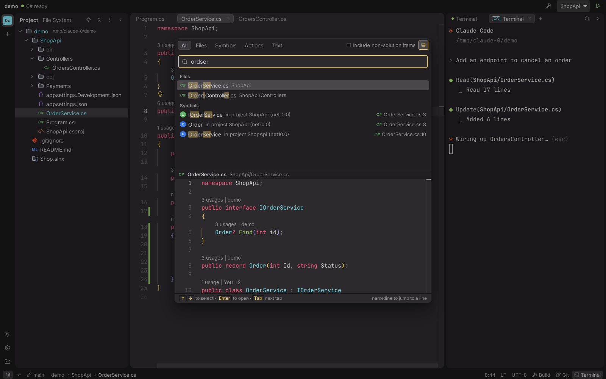
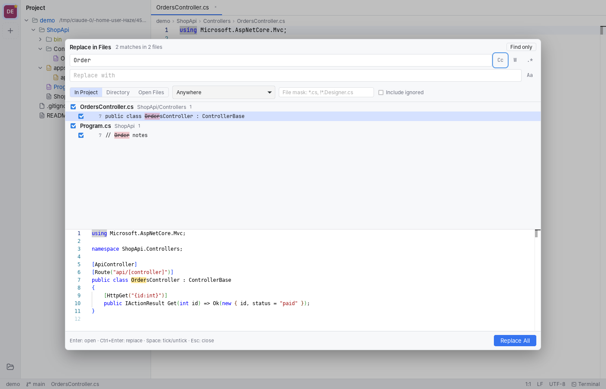
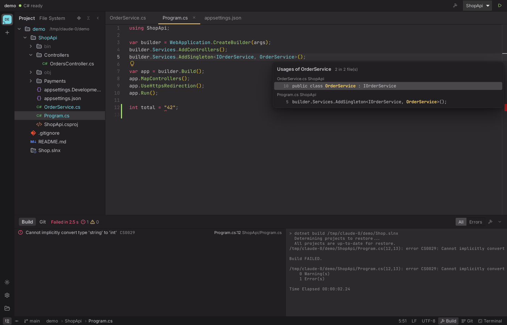
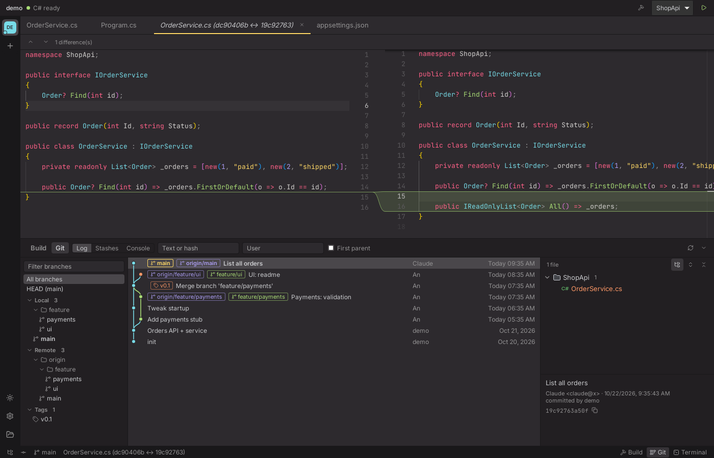
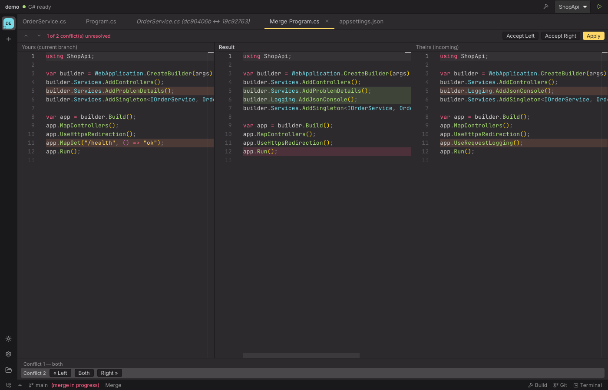
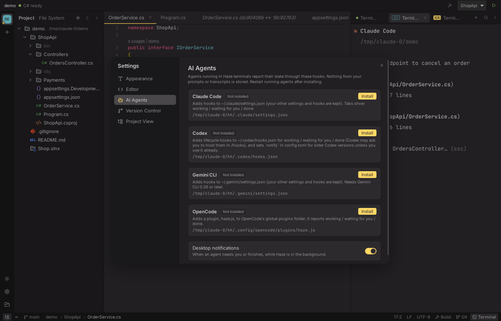
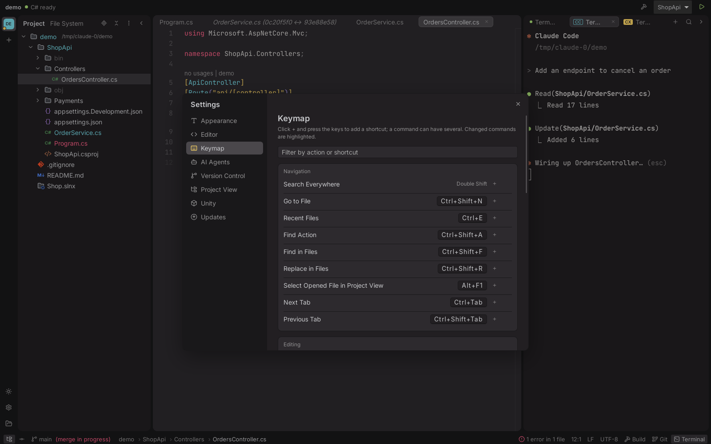

# Haze features

The full feature reference. For an overview, see the [README](../README.md).

## Projects and file tree

- Multiple projects in a sidebar with favorites, ordering and a Welcome screen of recent projects.
- Drag a file or folder from Finder or the file manager onto the window to open it (a folder opens as a project; a file opens in the project that contains it, or in its folder).
- Full session restore: open projects, expanded folders, editor tabs, panel sizes and terminals.
- Dark and light themes (switch from the project rail), and two layouts (**Settings → Appearance → Layout**): **Classic**, panels edge to edge, or **Islands**, like Rider's Islands UI: Project, editor, terminal and Build/Git as rounded blocks with gaps between them, and tabs as rounded chips. The screenshots use Islands.
- **Background image or video** behind the Islands layout (**Settings → Appearance → Background**): the panels turn into tinted glass over it, with an optional **ambient glow** in its colours around each island and an **agent status glow** on the terminal. Images and MP4/MOV/WebM videos; no GIFs, which cost several times what a video does. See [Background images and videos](BACKGROUND.md) for the benchmark.
- Lazy-loaded, virtualized file tree that updates live when files change on disk, with JetBrains' file and folder icons (light and dark).
- Rider-style views: **File System**, and for Unity projects a **Unity** view that lists `Assets` and the packages the project references (registry, git and local), hiding `.meta` files and Unity-hidden assets until *Show All Files* is on. Renames, moves and deletes in a Unity project take the asset's `.meta` along. *Select Opened File* (or *Always Select Opened File*) and *Collapse All* in the header.
- Rider-like Git status colors (modified, added, untracked, ignored, conflicted), propagated to parent folders.
- Rider-style file nesting: `appsettings.Development.json` under `appsettings.json`, `Index.razor.cs` under `Index.razor`, `Strings.Designer.cs` under `Strings.resx`, and so on.
- New File/Directory (`Alt+Insert`), Rename (`Shift+F6`/`F2`), Delete to trash (`Cmd+Backspace` on macOS; open tabs of deleted files close, after a warning if unsaved), Cut/Copy/Paste, drag and drop (hold `Ctrl` to copy), Copy Path, Open in Terminal, Reveal in File Manager.

## Editor (Monaco)

- Preview tabs (single click opens a temporary tab; double-click or editing pins it). Tabs that do not fit go behind a ▾ list, like Rider.
- **Split editors**, like Rider: *Split Vertically/Horizontally*, *Split and Move Right/Down*, *Move to Opposite Group*, *Unsplit* and *Unsplit All* in the tab menu and Find Action, and splits within splits, resized by dragging between them. Drag a tab to another tab bar, onto a side of an editor to split there, or out of the window. `Shift+Enter` in the Project view opens the file in the split to the right. Assign keys in Settings → Keymap → Editor Splits (Go to Next Splitter too).
- **Editor windows**: *Open in New Window* (`Shift+F4`, from a tab or the Project view, or a tab dragged out of the window) moves a tab into an OS window of its own, with its own tabs and splits. Drag its tabs back onto the main window's (or another editor window's) tab bars and editors to move or split them there, or use *Move to Main Window*; a window left without tabs closes. Closing it closes its tabs. Splits and windows are restored with the session.
- **Rainbow brackets** and rainbow scope guides (Settings → Editor).
- **Change markers** beside the line numbers, like Rider: added lines (green), modified (blue) and deletions since `HEAD`, following unsaved edits.
- **Inline blame** at the end of the caret line (`Author, 2 days ago • summary`, details on hover), like GitToolBox.
- Path breadcrumb in the status bar: click a folder to browse it, the file to list its siblings.
- Sticky scroll, and wheel scrolling without easing (one line per wheel notch, trackpads 1:1). Code Vision, inline blame and sticky scroll can be turned off in **Settings → Editor**.
- Preserves encoding (UTF-8, UTF-8 BOM, UTF-16; legacy non-UTF-8 files are read and written as Windows-1252, and stray invalid bytes in UTF-8 files are kept, so no byte is ever lost) and line endings (LF/CRLF); writes atomically via a temp file.
- **No silent overwrites**: clean buffers reload when the agent edits the file; dirty buffers show *Load disk version* / *Overwrite with mine*; saving is blocked if the file changed on disk.
- Unsaved drafts survive app restarts.
- **Copy Context** (`Ctrl+Shift+C`): copies the selection with `path/to/File.cs:7-9` and a Markdown code fence, ready to paste into an agent.
- Rider keymap: `Ctrl+D` duplicate line, `Ctrl+Y` delete line, `Ctrl+W`/`Ctrl+Shift+W` extend/shrink selection, `Alt+J` next occurrence, `Alt+Shift+↑/↓` move line, `Alt+F1` select in Project view.
- Markdown preview and image viewer.

## Search

- **Search Everywhere** (double `Shift`) with All / Files / Symbols / Actions / Text tabs, in Rider's look, with an optional code preview pane. Rider-like fuzzy matching (`ordcon` → `OrdersController.cs`), `Name.cs:12` jumps to a line; Go to File ranks scripts first. *Include non-solution items* (or double `Shift` again) widens the search to files outside the solution. Also `Ctrl+Shift+N` Go to File, `Ctrl+Shift+A` Find Action, `Ctrl+E` Recent Files.
- **Find in Files** (`Ctrl+Shift+F`) / **Replace in Files** (`Ctrl+Shift+R`):
  - Rider's layout: a movable, resizable popup with one row per match (in the editor's font and colours, file and line on the right) above a code preview; pin it to keep it open while visiting matches; recent searches (`Alt+↓`) and file mask history.
  - Full regex (lookaround, backreferences), `$1` / `${name}` replacements, Match case, Words, Preserve case.
  - Scopes as in Rider: **In Solution** (the files the `.csproj` files list), **Project** (one `.csproj`), Directory, Open Files, plus *Include non-solution items*; file masks like `*.cs, !*.Designer.cs`; skips `bin/`, `obj/`, `node_modules/` and `.gitignore`d files by default.
  - C# context filter powered by tree-sitter: anywhere, only in comments, only in string literals, or everything except those.
  - Open files are searched and replaced in their unsaved buffers (undoable); other files are written on disk with encoding, BOM and CRLF preserved.
  - Every match is re-checked before writing: files that changed since the search (for example, edited by the agent) are skipped and reported.
  - Per-match preview with checkboxes, *Replace* for the selected occurrence only, and a one-click **Undo** for the whole replace.




## C# and .NET

- Uses Microsoft's **Roslyn Language Server** (`roslyn-language-server` .NET tool), with `csharp-ls` as a fallback. If it is missing, Haze offers a one-click **Install** (the .NET SDK too, through Homebrew, winget or Microsoft's `dotnet-install` script, when `dotnet` is not found) (**Use Roslyn** when C# runs on `csharp-ls`), then starts C# again with it. A project's C# server (and Unity index) starts when the project is first shown, not for every project open in the sidebar.
- Rider-style navigation: `Ctrl+B`/`Ctrl+Click` Go to Definition, `Alt+F7`/`Shift+F12` Find Usages, `Ctrl+Alt+B` Go to Implementation, `Ctrl+F12` File Structure, `Shift+F6` cross-file Rename (single undo), `Alt+Enter` Roslyn quick fixes and refactorings, `Ctrl+Alt+L` format, plus hover, completion, signature help and highlights.
- `Ctrl+Click` on a declaration lists its usages, like Rider. Usage and declaration lists (instead of Monaco's peek view) open just under the symbol, one row per usage coloured like the editor. *Open in Find Window* (or `Alt+F7` again) moves them to a **Find** tool window: a tree of files and usages with a code preview, Rerun, Previous/Next Occurrence and Pin Tab.
- Go to Definition into DLLs (UnityEngine, the BCL, source generators) with `csharp-ls`: decompiled code opens in a read-only tab.
- **Code Vision** above types and members (`3 usages | author +1`); the count opens Find Usages. Unused private members are greyed out (Unity messages, attributes, overrides and public API are left alone). Lenses show as soon as a file opens (Haze parses it itself), with the last counts until the server has counted again; Roslyn counts through its own CodeLens, fast even in a large Unity solution (an interface implementation also counts the calls made through the interface, as in Visual Studio).
- Rider-like highlighting: a C# grammar that tells methods, types, attributes, doc comments and directives apart, then Roslyn's semantic tokens once the projects load.
- **Shaders**: highlighting for Unity's ShaderLab (`.shader`, with its `CGPROGRAM`/`HLSLPROGRAM` blocks as HLSL), HLSL (`.hlsl`, `.cginc`, `.compute`, Unreal's `.usf`…) and GLSL (`.glsl`, `.vert`, `.frag`…): types, functions, semantics, attributes and directives; comment toggling and bracket matching; a file icon of their own.
- **Inline completions**: as you type a name, the rest of Roslyn's best completion shows as ghost text; `Tab` accepts it, with the `using` it needs.
- **Other languages** (TypeScript/JavaScript, Python, C/C++, Go, Rust, Java, shaders…), and C# while Roslyn is still loading or not installed: `Ctrl+Click`/`Ctrl+B` and `Alt+F7` work from a fast text search of the project. The current file is checked first (so local variables resolve to the nearest declaration above), then the project; no types are resolved, so a name declared in several places shows them all.
- **Errors as you type**, like Rider's inspections: Roslyn's errors (red), warnings (yellow), suggestions (green) and hints (a dashed green under the first letters, left off the error stripe), from the compiler and the project's analyzers, Microsoft.Unity.Analyzers among them. They show once the projects have loaded, never for a file Roslyn has no project for, and a project that lost its references (a Unity Editor moved or removed) shows only syntax errors and says so. In Unity projects the advice Unity's analyzers would suppress is left out (unused Unity messages, `[SerializeField]` fields "never assigned", `?.` and `??` on Unity objects). The editor's top-right corner counts the file's errors, warnings and suggestions (a green check when there are none); click it to go to the next one.
- `Alt+Enter` (and `Cmd+.`/`Ctrl+.`) on a problem lists the fixes for it first; for a missing namespace, `using UnityEngine;` comes first, as in Rider.
- **Ignoring a rule**: `Alt+Enter` on a warning or suggestion with a rule ID (`IDE0130`, `CS0168`, `CA1822`…) also offers *Suppress … with #pragma* (`#pragma warning disable`/`restore` around those lines), *Disable … in .editorconfig* (`dotnet_diagnostic.<ID>.severity = none` in the `[*.cs]` section of the project's top `.editorconfig`, made at its root when there is none) and *Ignore … in all projects*, a Haze setting that hides the rule everywhere, build warnings included; the list is in Settings, Editor, *Ignored C# rules*. Errors cannot be ignored.
- **Build errors**: `Ctrl+Shift+B` runs `dotnet build`; the Build panel lists MSBuild errors and warnings and the editor shows squiggles, which clear for a file as soon as you edit it (a build's error replaces the same live one). The status bar reads *N errors in M files*; click it to go to the next error.
- **Run bar** built from each project's `launchSettings.json` (and `dotnet test` for test projects). `Shift+F10` runs in its own terminal tab, which survives closing Haze.
- Files created, changed or deleted by the agent are reported to Roslyn (`workspace/didChangeWatchedFiles`), so navigation always reflects the latest code. Even a huge change (a branch checkout, a Unity reimport) still reports its sources; if the OS dropped file events, Roslyn reloads the projects.
- If Roslyn finds no definition (for example a new Unity script that Unity has not added to its `.csproj` yet), `Ctrl+Click` falls back to the text search. A crashed server restarts on its own (up to 3 times in a row).
- **Unity**: add the [`com.aprius.ide.haze`](../unity/com.aprius.ide.haze) package (*Package Manager → Add package from git URL* → `https://github.com/aprius/Haze.git?path=/unity/com.aprius.ide.haze`) and pick Haze as External Script Editor. Unity then generates the `.sln`/`.csproj` files for Haze (following build target, defines and `csc.rsp`; packages, player projects and Microsoft.Unity.Analyzers chosen in *External Tools*, like Rider) and opens scripts and console errors in Haze at the right line.
  - **Live link to the Unity Editor**, like Rider's: `Ctrl+Shift+B` makes Unity import and compile, and the Build panel and editor markers show Unity's own compiler errors (no `dotnet build`). Unity's **Console** is a tool window (filters, Collapse, search, Clear on Play; stack frames open the file). **Play / Pause / Step** and **Refresh** sit in the title bar. Files saved in Haze or written by an agent are imported by Unity right away, without switching to it (Settings → Unity; skipped in Play Mode).
  - **New scripts join their project at once**: a script Unity has not added to its `.csproj` yet (just created by you or an agent, Unity closed) goes into its assembly's project (from the `.asmdef` above it, or Assembly-CSharp, `-Editor`, `-firstpass`), as Rider does, so it gets errors and `using` fixes right away. Unity's next project generation writes the same line.
  - **Performance-critical context**, like Rider's: event functions Unity calls every frame (Update, LateUpdate, FixedUpdate, OnGUI…), coroutines, and the methods of the class they call get a bar in the gutter; expensive calls in them (GetComponent, AddComponent, Find, `transform.Find`, Camera.main, Debug.Log, SendMessage, `Invoke("Name")`, `IsInvoking("Name")`, and calls to methods that make them), comparisons of a Unity object to `null` and multidimensional array accesses (`grid[x, y]`) are underlined, with the advice on hover. Calls are followed within the class, in the same file. Settings → Unity: everywhere, current method only, or never.
  - **Names checked against the project**, like Rider's inspections: a tag (`CompareTag`, `FindWithTag`, `.tag == "…"`), layer (`LayerMask.NameToLayer`, `GetMask`), input axis or button (`Input.GetAxis`, `GetButton…`), scene (`SceneManager.LoadScene`: not in the Build Settings, disabled there, ambiguous, no such scene, an index past the last one; `EditorSceneManager.OpenScene`), Resources path (`Resources.Load`, `LoadAll`; with a file extension it won't load), Animator state (`Play`, `CrossFade` on an `Animator`) or shader (`Shader.Find`, Unity's built-in shaders included) the project does not have gets a warning. Constants are followed (`const string EnemyTag = "Enemy"`). Inside such a string, completion lists the project's tags, layers, scenes… Read from `ProjectSettings` and the project's files, no Unity needed; what Haze could not read (a binary-serialized setting) is not checked.
  - **Instantiate, then set the parent** (`var go = Instantiate(prefab); go.transform.SetParent(root);`) is pointed out: the hierarchy is built twice. `Alt+Enter` passes the parent to `Instantiate` instead.
  - **Assembly definitions** (`.asmdef`) open as JSON and are checked: references to assemblies the project and its packages do not have (by name or GUID), to the assembly itself, references by name that a GUID would keep working through a rename, a file name that does not match the assembly, and malformed define constraints and version defines.
  - **Unity-aware code**, from the project's files (no Unity needed, indexed as the project opens, scripts before scenes): classes are traced through their base classes, in your code and in package sources, to MonoBehaviour, ScriptableObject, Editor, EditorWindow or AssetPostprocessor. Their event functions show **Event function** in Code Vision instead of "no usages", and are never greyed out. Typing `OnTrig` in a class body completes `private void OnTriggerEnter(Collider other)`; **Generate** (`Alt+Insert`, `Ctrl+Enter` on macOS) lists the event functions not declared yet.
  - **Asset usages**: Code Vision shows how many scenes, prefabs and assets use a script, and which UnityEvents call a method (`2 asset usages`), with the GameObject names; picking one selects it in Unity (or opens the file when Unity is not linked).
  - **Unity tests**: `▶ Run` above `[Test]`/`[UnityTest]` methods and their classes runs them in Unity (Edit and Play Mode), with the last result beside it (`✓ passed`, `✗ failed`); the **Tests** tool window lists the run, with messages, stack traces and output, and reruns failures.
- Command line: `haze <folder> [<file>] [--line N] [--column N]` opens a project or file; a running Haze is reused.



## Git

A Rider/Rebased-style Git client built on top of the system `git` CLI.

- **Commit** (`Alt+0`, `Ctrl+K`): a separate OS window (it can leave Haze's window, like Rider's) with the changes and message beside the selected file's diff (`Ctrl+D` opens the diff in a floating window of its own); check the files to commit without staging; files edited but not saved count as changes; multi-select (`Ctrl`/`Shift`+click) to roll back or diff several files; Changes / Unversioned Files / Merge Conflicts groups; a unified preview of the selected file (removed lines shown between the current ones, like Rider's); Amend, Commit and Push, Rollback, Add to VCS, Add to `.gitignore`; Continue/Abort banner during merge or rebase.
- **Git log** (`Alt+9`): branch graph, branch/tag/remote labels, filters by text, hash, author, branch, path and first parent; resizable panes; commit details with the changed files as a directory tree (added green, modified orange, deleted red); a **Console** tab with every git command Haze ran.
- Commit actions: Checkout, New Branch, New Tag, Cherry-Pick, Revert, Undo Commit, Reset to Here (Soft/Mixed/Hard), **Interactive Rebase from Here** (pick / reword / edit / squash / fixup / drop, no text editor needed).
- **Branches** popup (status bar or ``Ctrl+Shift+` ``): checkout with **Smart Checkout** (auto-stash), new, merge, rebase, compare, push, rename, delete, delete remote; Fetch.
- **Push** (`Ctrl+Shift+K`) with a preview of outgoing commits and `--force-with-lease`; the target reads `branch → remote : target` as in Rider, editable in place and tagged *New* when the remote lacks it. **Pull** dialog to pick the remote and branch (`Alt+P` on macOS). **Update Project** (`Ctrl+T`) via merge or rebase with auto-stash. Commands that touch the working tree (stash, checkout, reset…) save all files first.
- **Diff** tabs in Rider style: no filler lines, curved connectors between matching blocks, scrolling kept in step block by block, word-level highlights, `F7`/`Shift+F7` to jump between changes, sides resized by dragging the gap (double-click splits evenly); editable on the working-copy side, where the `>>` gutter icon reverts a block to the left side (hold `Ctrl` on a modified block to append the left lines below it instead). Annotate with Git Blame, Show History for File, Compare with HEAD.
- **Conflict resolution**: Accept Yours / Accept Theirs, or a **3-way merge view** (Yours | Result | Theirs) with non-conflicting changes pre-merged.
- **Stashes**: view, apply, pop, drop, unstash as branch, stash including untracked files.
- **AI checkpoints**: snapshot the whole working tree (including new files, without touching index or branches) before letting an agent run; *Since checkpoint* lists every file it changed, with diffs.
- **Reviewed marks** per file, cleared automatically when the file changes again.
- **GitHub / GitLab accounts** (Settings), like Rider: log in with a token (GitHub, GitHub Enterprise, GitLab.com or self-hosted GitLab; *Generate…* opens the token page with the right scopes) or *Log In via GitHub…* in the browser. Tokens are kept in the system keychain, and push/pull/fetch to that server use the account through Haze's own credential helper, ahead of any stored credential (other hosts keep your git setup). A push rejected for credentials offers *Log In…*.
- Never blocks on a password prompt (`GIT_TERMINAL_PROMPT=0`); other hosts use your credential helper or SSH agent.




## Terminal

- Docked to the right of the editor (Build and Git sit below). Shells run in a separate **PTY host** process: closing or updating Haze does not kill shells or running agents. On reopen Haze reattaches and replays recent output (4 MB per session).
- Multiple tabs, search in output (`Ctrl+F`), `Ctrl+C` copies when there is a selection. `Shift+Enter`/`Alt+Enter` insert a newline (for agent prompts). Files copied in Finder paste as their paths.
- `Ctrl+Click` on paths opens the file at line/column, including MSBuild format (`Program.cs(12,5): error CS1002`) and `file:line:col`. Relative paths resolve against the shell's current directory (after `cd`; on Windows the shell must report it via OSC 7 / OSC 9;9, as Starship or oh-my-posh do).
- `Alt+F12` (`Cmd+J` on macOS) toggles the terminal, `Alt+1` toggles the Project view.
- `HAZE_TERMINAL_ID` is set in every terminal so agent hooks know which tab they run in.

## AI agents

- **Settings** (`Ctrl+Alt+S`; pages for Appearance, Editor, Keymap, AI Agents, Version Control, Project View, Unity and Updates) installs status hooks, keeping your other settings and hooks (a `.haze-backup` copy is made on the first write; remove them anytime):
  - **Claude Code**: hooks in `~/.claude/settings.json`.
  - **Codex**: lifecycle hooks in `~/.codex/hooks.json` (Codex may ask you to trust them in `/hooks`), plus `notify` in `config.toml` for older versions unless you use it already.
  - **Gemini CLI** (0.26+): hooks in `~/.gemini/settings.json`.
  - **OpenCode**: a `haze.js` plugin in `~/.config/opencode/plugins/`.
- **No hook needed** for agents that print their state: Haze reads its own `OSC 6973;<state>[;<agent>[;<message>]]`, which any script can print (`printf '\e]6973;working;mybot\a'`; states: idle, working, waiting, done, error, clear), and notifications (`OSC 9`, `OSC 777`) that name Claude, Codex, Gemini or OpenCode. Once an agent is known, the progress sequence `OSC 9;4` updates it while that program is in front; a progress bar alone (`dotnet build` draws one) does not count. An installed hook takes precedence.
- Terminal tabs running an agent show a badge (**CC** Claude Code, **CX** Codex, **GM** Gemini, **OC** OpenCode): pulsing blue = working, yellow = waiting for you (permission, question), green = done, red = error. Projects in the sidebar show a matching dot.
- **Desktop notifications** when an agent needs you or finishes in a terminal you are not looking at.
- Status lives in the PTY host, so it survives Haze restarts. Prompts and transcripts are never stored.
- **Worktrees**: *New Worktree…* in the Branches popup creates `<repo>-<branch>` on a new branch and opens it as a separate project, so each agent gets its own worktree.
- **Command line** (`haze` on `PATH`), for scripts and for agents that hand work to other agents:

  ```bash
  haze agent claude --worktree fix/login "Fix the login redirect"   # new worktree, new terminal, prints its id
  haze agent codex -p "Write tests for OrderService"                # also gemini, opencode, or any command name
  haze run --dir src/Api -- dotnet watch                            # any command in a new terminal
  haze list                                                         # terminals and their agent state
  haze send 3f2a "Also update the docs"                             # type into a terminal and press Enter
  haze wait 3f2a --timeout 600                                      # until its agent is done, waiting or failed
  haze read 3f2a --lines 40                                         # the end of its output
  ```

  `agent` and `run` start your shell in the new terminal and type the command into it, then show the terminal in Haze (`--no-ui` to skip). Ids may be shortened to any unique prefix; inside a Haze terminal, `$HAZE_TERMINAL_ID` is its own.



## Keymap and updates

- **Keymap** page in Settings: every command with its shortcuts, Rider's defaults (the macOS ReSharper keymap on macOS); click **+** and press keys to add one, conflicts are shown, changed commands are highlighted and can be reset.
- **Check for Updates…** (app menu, or automatically every few hours, Settings → Updates) compares the build with the latest GitHub release. **Update Now** updates a Homebrew install through `haze update` in Terminal. Otherwise Haze downloads the release with a progress bar, checks it against GitHub's checksum and restarts into it: it replaces Haze.app (macOS), the AppImage (Linux) or haze.exe (Windows), and terminals keep running. A .deb or .rpm install, or Haze in a folder it cannot write (an MSI install under Program Files), opens the release page instead. Nothing is downloaded or installed until you choose to. **About Haze** in the app menu.


